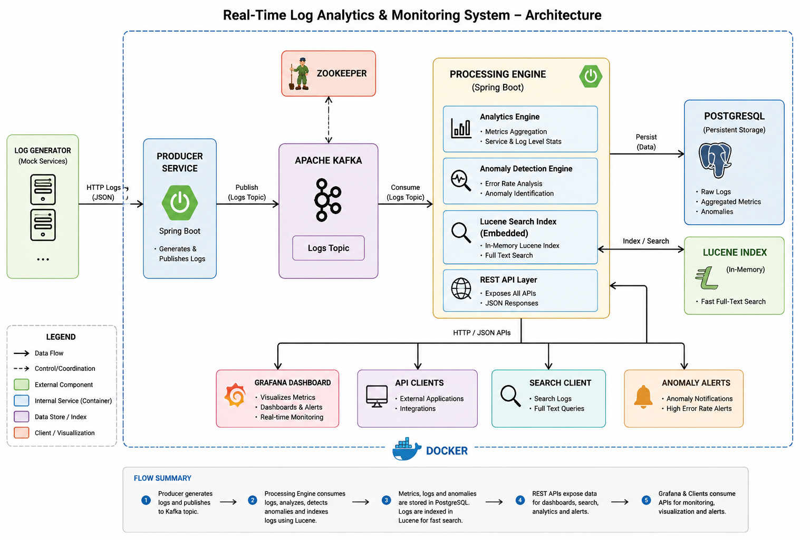
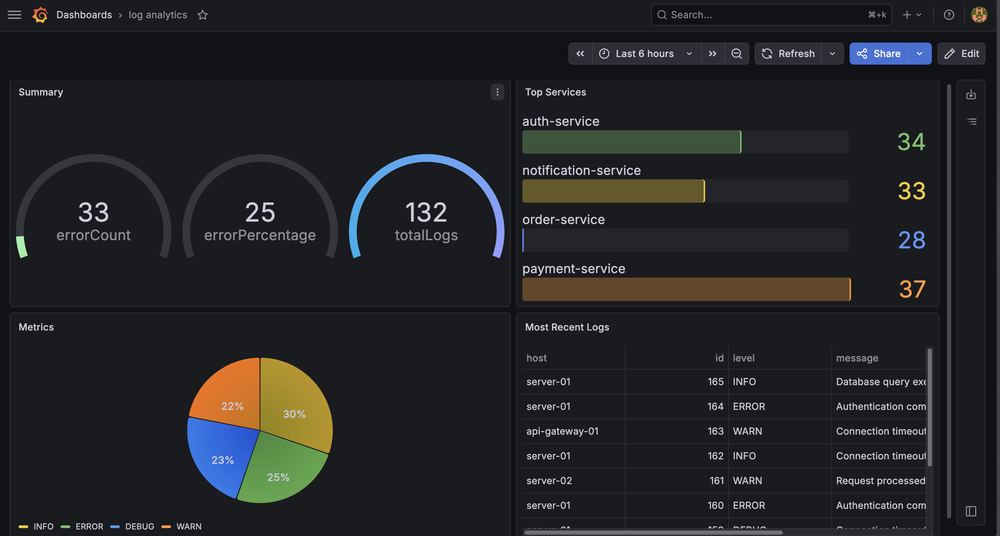
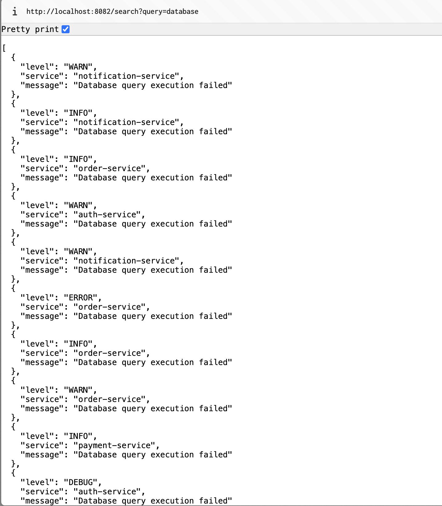
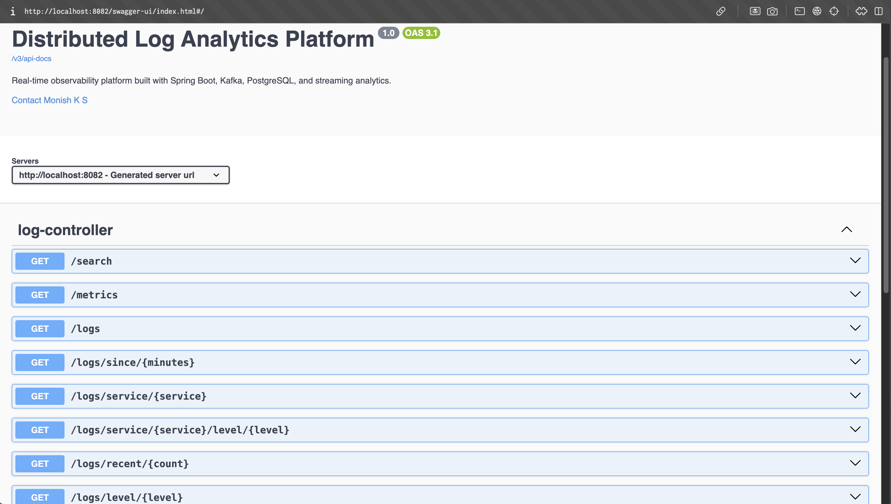
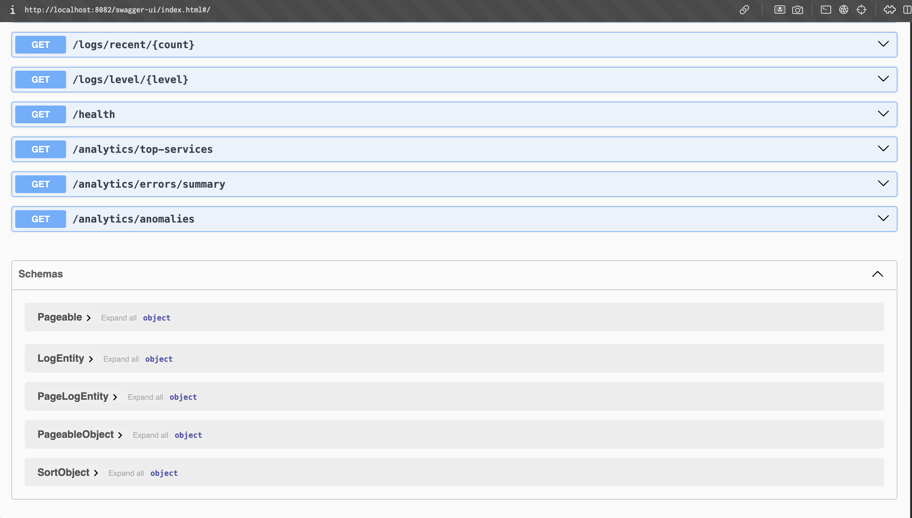

# 🚀 Real-Time Log Analytics & Observability Platform

A distributed real-time observability platform built using **Spring Boot, Apache Kafka, PostgreSQL, Grafana, Docker, and Apache Lucene**.

This platform ingests streaming logs, processes analytics in real time, detects operational anomalies, supports full-text search, and visualizes live metrics through Grafana dashboards. 

---

# 🏗️ Architecture



---

# ✨ Features

## 📡 Real-Time Streaming

* Kafka-based distributed log ingestion pipeline
* Event-driven asynchronous architecture
* Continuous streaming analytics

---

## 📊 Live Analytics

* Log level aggregation
* Service-wise log distribution
* Error summaries and metrics
* Top active services tracking

---

## 🚨 Anomaly Detection

* Detects unusually high error rates
* Real-time operational anomaly monitoring
* Exposes anomaly APIs for observability workflows

---

## 🔍 Full-Text Search

* Apache Lucene powered search engine
* Fast keyword-based log search
* Search indexed logs in real time

---

## 📈 Observability Dashboard

* Grafana dashboard integration
* Live operational visualization
* Metrics and analytics monitoring

---

## 🐳 Containerized Infrastructure

* Fully Dockerized architecture
* Multi-service orchestration using Docker Compose
* Production-style local deployment

---

## ✅ Testing

* Unit tested analytics pipeline
* Anomaly detection verification
* Mockito-based dependency mocking

---

# 📸 Screenshots

## 📊 Grafana Dashboard



---

## 🔍 Full Text Search Results



---

## 📘 Swagger / OpenAPI Documentation





---

# 🧰 Tech Stack

| Category       | Technologies            |
| -------------- | ----------------------- |
| Backend        | Java 21, Spring Boot 3  |
| Streaming      | Apache Kafka, Zookeeper |
| Database       | PostgreSQL              |
| Search Engine  | Apache Lucene           |
| Observability  | Grafana                 |
| Infrastructure | Docker, Docker Compose  |
| Testing        | JUnit 5, Mockito        |

---

# ⚙️ Core Components

## 🟢 Producer Service

Generates and publishes log events into Kafka topics.

### Responsibilities

* Simulated log generation
* Event publishing
* Kafka producer integration

---

## 🟠 Kafka

Acts as the distributed event streaming backbone.

### Responsibilities

* Decoupled communication
* Streaming transport
* Asynchronous event delivery

---

## 🔵 Processing Engine

Core analytics service responsible for processing incoming logs.

### Responsibilities

* Kafka consumption
* Analytics aggregation
* PostgreSQL persistence
* Lucene indexing
* Anomaly detection
* REST API exposure

---

## 🟣 PostgreSQL

Stores processed log records.

### Responsibilities

* Persistent storage
* Structured log retention

---

## 🟡 Apache Lucene

Provides full-text indexing and search capabilities.

### Responsibilities

* Log indexing
* Keyword-based search
* Fast retrieval of matching logs

---

## 🔴 Grafana

Visualizes analytics and observability metrics.

### Responsibilities

* Operational dashboards
* Live metrics visualization
* Real-time monitoring

---

# 📡 API Endpoints

| Method | Endpoint                                | Description                                     |
| ------ | --------------------------------------- | ----------------------------------------------- |
| GET    | `/metrics`                              | Returns log analytics and aggregated metrics    |
| GET    | `/search?query=database`                | Performs full-text log search using Lucene      |
| GET    | `/analytics/anomalies`                  | Returns detected anomalies based on error rates |
| GET    | `/analytics/errors/summary`             | Returns error statistics and summaries          |
| GET    | `/analytics/top-services`               | Returns most active services                    |
| GET    | `/logs`                                 | Returns all stored logs                         |
| GET    | `/logs/recent/{count}`                  | Returns most recent logs                        |
| GET    | `/logs/level/{level}`                   | Filters logs by level                           |
| GET    | `/logs/service/{service}`               | Filters logs by service                         |
| GET    | `/logs/service/{service}/level/{level}` | Filters logs by service and level               |
| GET    | `/logs/since/{minutes}`                 | Returns logs from recent time window            |
| GET    | `/health`                               | Service health check endpoint                   |

---

# 📘 Swagger / OpenAPI Documentation

Interactive API documentation is available at:

```text
http://localhost:8082/swagger-ui/index.html
```

---

# 🐳 Running the Platform

## ✅ Prerequisites

* Docker
* Docker Compose
* Java 21
* Maven

---

## ▶️ Start Entire Platform

From the `docker` directory:

```bash
docker compose up
```

---

## ⏹️ Stop Platform

```bash
docker compose down
```

---

# 📦 Dockerized Services

| Service           | Purpose                 |
| ----------------- | ----------------------- |
| Zookeeper         | Kafka coordination      |
| Kafka             | Event streaming         |
| PostgreSQL        | Log persistence         |
| Producer Service  | Log generation          |
| Processing Engine | Analytics & APIs        |
| Grafana           | Dashboard visualization |

---

# 📈 Grafana Dashboard Access

Grafana runs at:

```text
http://localhost:3000
```

## Default Credentials

```text
Username: admin
Password: admin
```

---

# 🧪 Testing

Run unit tests:

```bash
./mvnw test
```

## Covered Tests

* Analytics service logic
* Error aggregation
* Anomaly detection validation
* Mocked dependency testing

---

# 🧠 Engineering Concepts Demonstrated

* Distributed systems architecture
* Event-driven design
* Real-time stream processing
* Search indexing systems
* Observability engineering
* REST API design
* Docker orchestration
* Backend service testing
* Asynchronous processing

---

# 🔮 Future Improvements

* Persistent Lucene index storage
* Advanced search filters
* Time-series analytics
* Prometheus integration
* Alerting system
* Kubernetes deployment
* Authentication & RBAC

---

# 👨‍💻 Author

**Monish Gowda**
